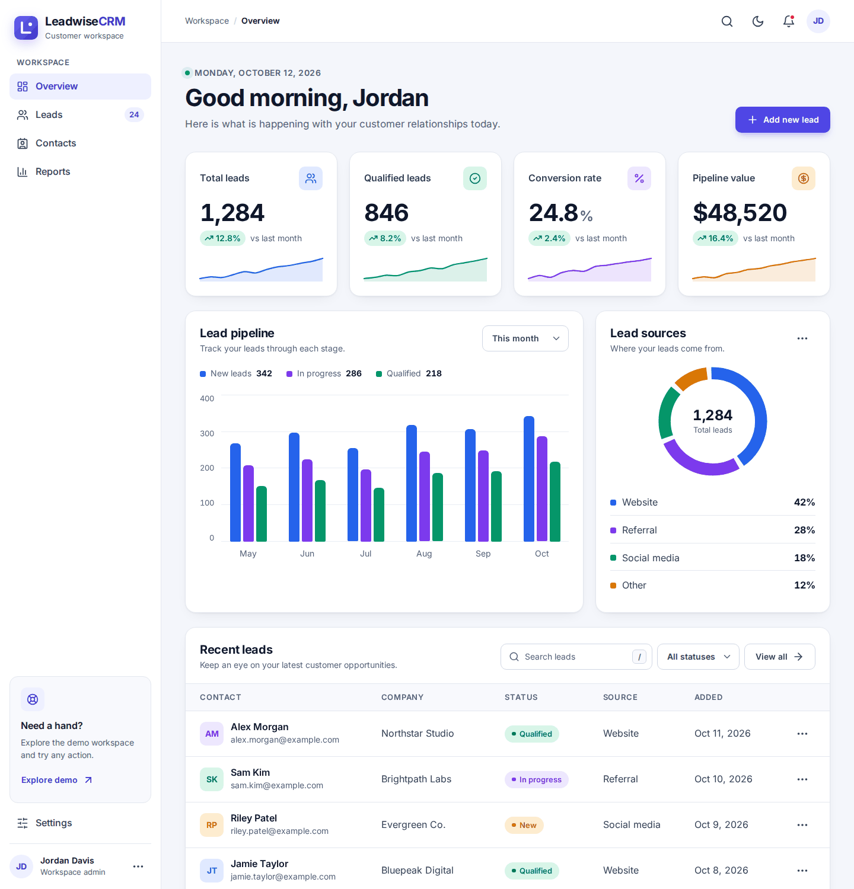
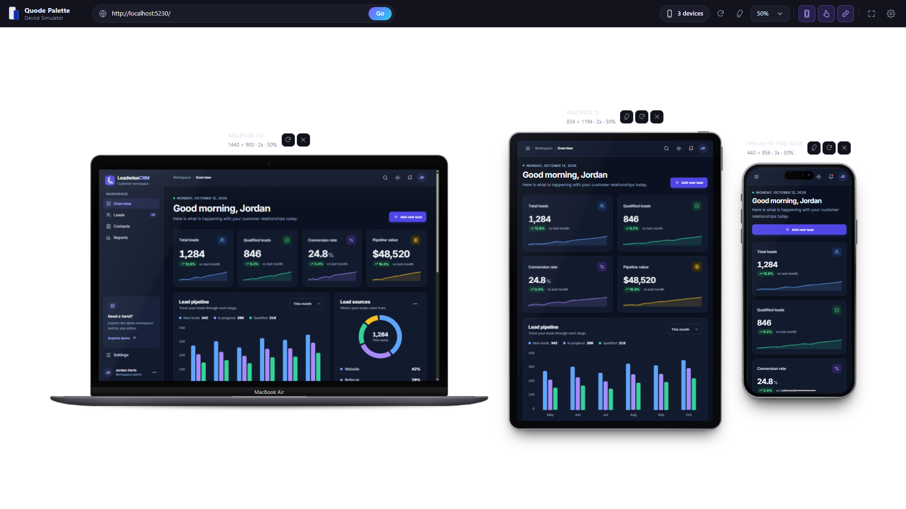

# Leadwise CRM

Leadwise CRM is a frontend demo of a customer dashboard. It has animated stats, a lead pipeline chart, lead sources and a lead table you can search and filter. There is a light and a dark theme, and it works on phones, tablets and desktops.

Everything on the page is sample data. There is no login, nothing is saved and no database is needed.





## What is inside

- A light and dark theme. It follows your system at first, then remembers your choice.
- Numbers that count up and charts that draw in when they scroll into view. People who prefer reduced motion get a calm version.
- A readable type scale. Nothing on the page is smaller than 13px.
- Clean SVG icons and a favicon set.
- A lead table with live search, a status filter and a `/` shortcut to jump to the search box.
- Keyboard friendly navigation, visible focus, a skip link and screen reader labels.
- A self hosted font, so the page makes no third party requests.

## Demo Link

[Visit the LeadWise Live Site](https://leadwise.quodepalette.com)

## Run it

You need the .NET 10 SDK.

```powershell
dotnet restore
dotnet run
```

Then open the local address printed in the terminal.

## Project structure

- `Program.cs` serves the static files and adds security headers, caching and compression. It also builds `/llms.txt`.
- `wwwroot/index.html` is the dashboard markup.
- `wwwroot/css/demo.css` holds the styles. All colors live in the token block at the top.
- `wwwroot/js/demo.js` handles the theme toggle, animations, search, filters and toasts.
- `wwwroot/js/theme-init.js` applies the saved theme before the first paint.
- `wwwroot/fonts` has the Inter font and its license.

## Good to know

- Most buttons show a small toast instead of doing something. They are placeholders for a future backend.
- CSS, JavaScript and fonts are cached for a year. When you change one of those files, bump the `?v=` value on its link in `index.html`.
- The strict Content Security Policy blocks inline scripts and styles. Keep new code in the `.js` and `.css` files.

## Performance and quality

In local Lighthouse runs the page scored 100 for Accessibility, Best Practices, SEO and Agentic Browsing. Performance was 100 on desktop and 99 to 100 on mobile. Scores on PageSpeed Insights can move a few points depending on the test server and your hosting.

## Next steps

A future version can connect the interface to an API, add sign in and store leads in a database.

## Credits and license

The project is covered by the [LICENSE](LICENSE). The Inter font is by the Inter Project Authors and is used under the SIL Open Font License, see `wwwroot/fonts/Inter-OFL.txt`.
